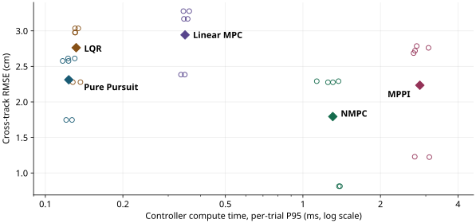
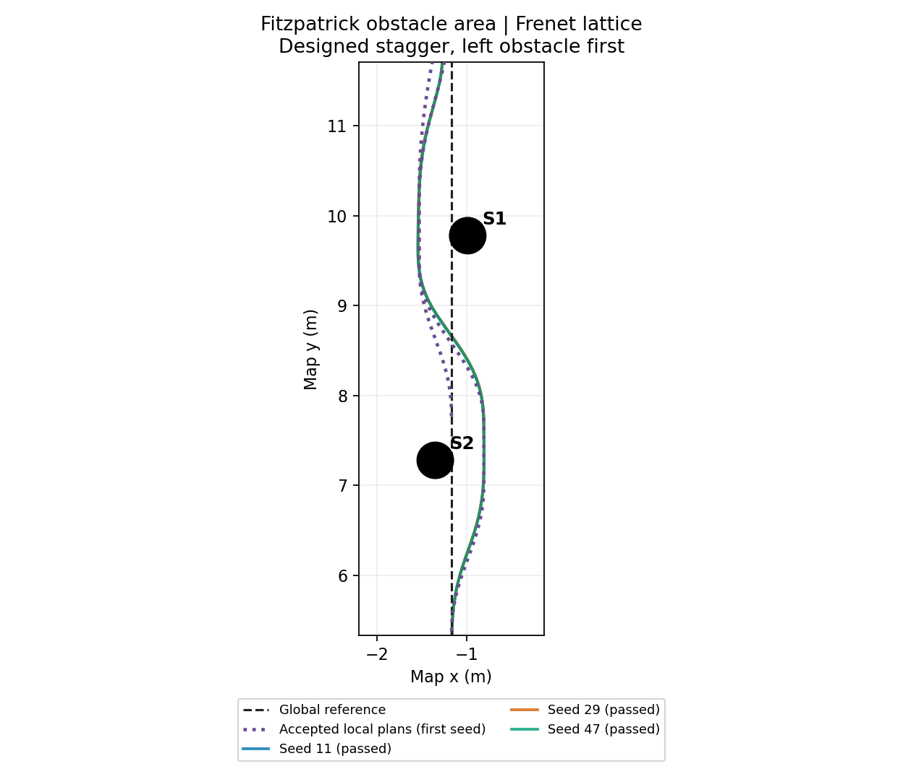

# F1TENTH Planning and Control Comparison

## Abstract

This benchmark studies two questions on the 44.73 m Fitzpatrick circuit. How much tracking accuracy does each controller achieve for its computational cost? How reliably does each local planner guide the car around static obstacles, back onto its route, and to a stop? The experiments use a single Ackermann vehicle in F1TENTH Gym and hold the map, reference route, and finish criteria fixed within each comparison.

Each of the five tracking controllers completed six of six trials. Nonlinear model predictive control (NMPC) achieved the lowest mean cross-track error at **1.79 cm**. Pure Pursuit achieved **2.31 cm** with the lowest controller runtime. In the obstacle experiment, the five planning and control configurations completed **112 of 120 trials**. Hybrid A* and the car-like timed elastic band completed all 24 trials assigned to each. These figures describe the tested route, speeds, and obstacle layouts. [Controller results](results/fitzpatrick_tracking_20261120/comparison.csv) · [Planning trial records](results/fitzpatrick_local_design_20261120/campaign/trials.json)

## Experimental design

The simulator advances vehicle dynamics at **100 Hz** and updates control at **20 Hz**. The route speed reference peaks at **2.0 m/s**. A successful lap includes a stop at the finish. The obstacle experiment also requires the vehicle to return to the reference route after avoidance.

| Experiment | What varies | What the vehicle observes | Trials |
|---|---|---|---:|
| Fixed-route tracking | Five controllers, three start poses, two seeds | Simulator vehicle state and a common route and speed reference | 30 |
| Static obstacle avoidance | Five local planning configurations, eight layouts, three seeds | Simulator ego pose, the known background map, and obstacle estimates from noisy LiDAR scans | 120 |

Tracking trials start from rest, either centered or displaced 0.10 m left or right with a corresponding 4° heading offset. In the avoidance trials, obstacle ground truth is used for scene generation and independent clearance scoring. The planner receives the scan-derived estimates. Hybrid A*, Frenet lattice, kinematic RRT*, and the car-like timed elastic band (TEB) provide references to NMPC. The Ackermann dynamic window approach (DWA) selects speed and steering directly. The avoidance results therefore measure each complete planning and control configuration. [Tracking protocol](docs/FITZPATRICK_FIXED_TRACKING.md) · [Planning protocol](docs/FITZPATRICK_LOCAL_PLANNING.md)

## Results

### Fixed-route tracking

| Controller | Completed | Cross-track RMSE (cm) | Heading RMSE (°) | Compute P95 (ms) |
|---|---:|---:|---:|---:|
| Pure Pursuit | 6/6 | 2.31 | 2.71 | 0.123 |
| Linear quadratic regulator (LQR) | 6/6 | 2.76 | 2.00 | 0.132 |
| Linear MPC | 6/6 | 2.94 | 1.83 | 0.349 |
| Nonlinear MPC | 6/6 | 1.79 | 1.71 | 1.306 |
| Model predictive path integral control (MPPI) | 6/6 | 2.23 | 2.07 | 2.845 |



*Figure 1. Each open circle represents one trial. Each diamond marks the arithmetic mean of that controller’s six trial values. Lower is more accurate and farther left is faster. The horizontal axis uses a logarithmic scale. Runtime is the 95th percentile of controller computation within each trial, measured on an AMD Ryzen 9 5900HX. It excludes simulator physics and interprocess communication.* [Trial-level measurements](results/fitzpatrick_tracking_20261120/trials.json) · [Trajectory plots](results/fitzpatrick_tracking_20261120/figures/)

The choice of error metric affects the comparison. Linear MPC had a lower mean heading error than Pure Pursuit (1.83° versus 2.71°), while Pure Pursuit held the car closer to the reference line (2.31 versus 2.94 cm). Seeds vary MPPI sampling. With exact state feedback, repeated runs of deterministic controllers mainly provide additional timing measurements.

A separate MPCC experiment lets the car choose its progress speed along the same route. All six simulations (three distinct initial poses, each repeated) reached the stopped finish, with zero collisions or boundary violations. Mean elapsed time including the finish dwell was **24.73 s**, mean per-trial lateral RMSE **2.08 cm**, and mean per-trial compute P95 **32.23 ms**. Six of 2,968 calls exceeded the 50 ms control period. This experiment uses a different speed objective from the five fixed-reference trackers and has no hardware timing validation. The first development solver hit its iteration limit on the centered start; the archived run used local route linearization and a smooth actuator response. [Trajectories](results/fitzpatrick_mpcc_20261121/figures/mpcc.png) · [Trial data](results/fitzpatrick_mpcc_20261121/trials.json) · [Development failure](results/fitzpatrick_mpcc_20261121/development/first_center/summary.json)

### Static obstacle avoidance

Each cell gives the number of successful runs out of **three**. A and B are two separate sites for 0.10 m obstacles. The matched layouts use 0.40 m cylinders. Each staggered layout adds a second cylinder 2.50 m downstream on the opposite side of the line. Left and right are relative to travel direction. [Layout map and dimensions](results/fitzpatrick_local_design_20261120/layout.png)

| Configuration | Clear | A | B | A + B | Single left | Single right | Stagger left first | Stagger right first | Total |
|---|---:|---:|---:|---:|---:|---:|---:|---:|---:|
| Hybrid A* + NMPC | 3 | 3 | 3 | 3 | 3 | 3 | 3 | 3 | **24/24** |
| Frenet lattice + NMPC | 3 | 2 | 3 | 1 | 3 | 3 | 3 | 3 | **21/24** |
| Kinematic RRT* + NMPC | 3 | 3 | 3 | 3 | 3 | 3 | 2 | 0 | **20/24** |
| Ackermann DWA | 3 | 3 | 3 | 3 | 3 | 3 | 3 | 2 | **23/24** |
| Car-like TEB + NMPC | 3 | 3 | 3 | 3 | 3 | 3 | 3 | 3 | **24/24** |



*Figure 2. Frenet lattice on the left-first stagger. Black discs mark the obstacles, the dashed line is the global reference, and the dotted line is the accepted plan for seed 11. The three simulated vehicle trajectories nearly coincide. All three runs passed.* [Per-layout results and figures](results/fitzpatrick_local_design_20261120/campaign/REPORT.md)

The staggered layouts exposed a difference hidden by the single-obstacle results. RRT* completed all six matched single-obstacle trials, then completed two of six when a second obstacle was added. Across all methods, the eight unsuccessful runs comprised **six controller rejections, one planner rejection, and one missed return to the reference route**. No collision or boundary violation was recorded before those trials terminated. [Paired layout results](results/fitzpatrick_local_design_20261120/campaign/paired_layouts.csv) · [All trial outcomes](results/fitzpatrick_local_design_20261120/campaign/trials.json)

## Embedded evaluation and limitations

On a Jetson Xavier NX, all ten methods produced valid outputs at all eight timestamps of a clear-track synthetic replay. In the obstacle replay, Hybrid A*, Frenet lattice, RRT*, and TEB took approximately **185, 73, 179, and 238 ms**, respectively, on their first active replan in the ten-method run. Each exceeded the **50 ms** control period, and the interface rejected its output. DWA returned valid outputs at all eight timestamps. These short replays measure computation and interface behavior on the target processor. Closed-loop vehicle evaluation of the ten benchmark configurations remains pending. [Jetson measurements](results/jetson_interface_20261120/replay_summary.json) · [Vehicle interface and capture procedure](vehicle_interface/README.md)

The campaigns use one mapped circuit, simulator ego pose, and three seeds per obstacle layout. The completion counts characterize these cases. A broader estimate of robustness would require additional tracks, localization errors, and repeated physical trials.

A supplementary closed-loop Gym experiment measures how sensor age and command delays affect all five fixed-reference controllers on Fitzpatrick. It includes synchronous, constant-mean, shuffled and burst-ordered synthetic timing. [Protocol and reproduction commands](docs/FITZPATRICK_TIMING.md) · [Fixed-reference results](results/fitzpatrick_timing_20261122/REPORT.md) · [Free-progress MPCC timing results](results/fitzpatrick_mpcc_timing_20261122/REPORT.md)

## Reproduction

Use Ubuntu 22.04 x86-64 and Python 3.10. Install the system packages listed in the setup guide, then run the following commands from the repository root. The GUI opens an interactive Frenet lattice trial with trajectory replay. [Installation and dependencies](docs/SIM_SETUP.md)

```bash
bash tools/setup_sim.sh
bash Code/sim_ws/run_fitz_tracking.sh                       # 30 controller trials
bash Code/sim_ws/run_fitz_tracking.sh --methods mpcc        # separate free-progress experiment
bash Code/sim_ws/run_fitz_local.sh --seeds 11 29 47          # 120 planning trials
bash Code/sim_ws/run_fitz_local.sh --gui                    # inspect a maneuver
.deps/sim_env/bin/python tools/plot_tracking_tradeoff.py    # regenerate Figure 1
```

The planning launcher saves successes and failures and returns a nonzero exit status when a scheduled trial fails. Trial traces, scenario definitions, and environment checksums are available for independent replay. [Tracking archive](results/fitzpatrick_tracking_20261120/) · [Planning archive](results/fitzpatrick_local_design_20261120/) · [Reproduction files](results/fitzpatrick_local_design_20261120/reproduction/)
